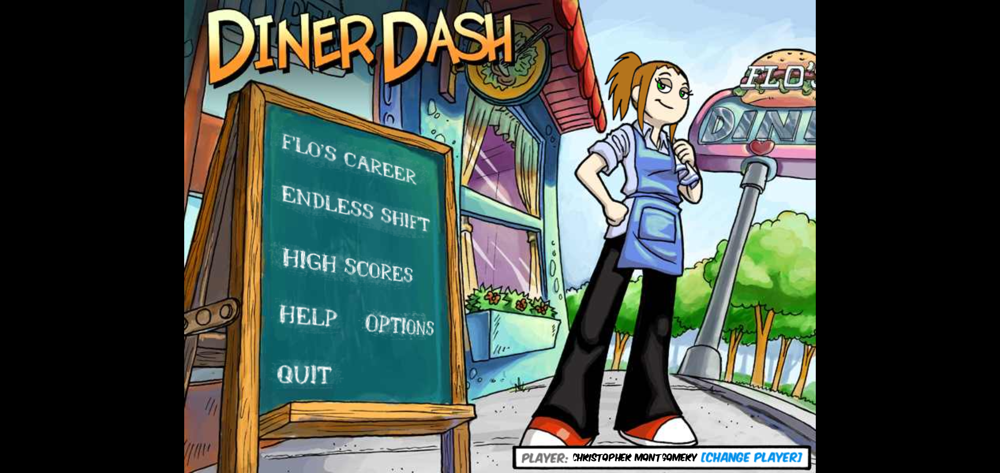
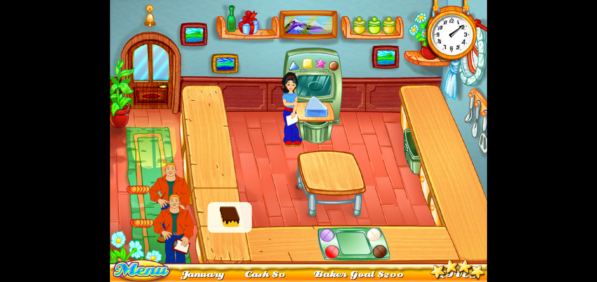

# 🎮 Native 2000 Games

Your childhood Windows games are moving into your pocket. Flo is serving tables. Jill is baking cakes. We are convincing their sprites to behave.

**Fully vibecoded.** This project was built through AI-assisted reverse engineering, coding, testing, and a heroic amount of “why is the chef floating?” debugging.

## Now serving

| Game | Latest build | Android source | Download |
| --- | --- | --- | --- |
| 🍽️ Diner Dash | `0.3.12` | [Open project](outputs/DinerDash-Android-prototype) | [APK](https://github.com/Myrarc/Native-2000-Games/releases/download/android-snapshot-2026-10-10/DinerDash-Android-0.3.12.apk) |
| 🎂 Cake Mania | `0.1.9` | [Open project](outputs/CakeMania-Android) | [APK](https://github.com/Myrarc/Native-2000-Games/releases/download/android-snapshot-2026-10-10/CakeMania-Android-0.1.9.apk) |

Both games run offline in landscape on **Android 6.0 or newer**. Current implementations use **Java and Android Canvas**.

| Diner Dash | Cake Mania |
| --- | --- |
|  |  |

## From Windows EXE to Android APK

[Ghidra](https://github.com/NationalSecurityAgency/ghidra) was used to **decompile and analyze the original 32-bit Windows code**, especially Cake Mania's native executable. We studied that pseudocode, recovered assets and configuration, translated the gameplay into native Android code, and **compiled it into runnable Android APKs**.

```text
Original Windows game
        ↓
Ghidra analysis + asset extraction
        ↓
Recovered rules, sprites, fonts and sounds
        ↓
Java / Android Canvas rebuild
        ↓
Playable Android APK ✨
```

Diner Dash also needed Director/Lingo and cast-asset recovery. Ghidra pseudocode is a reference for understanding the game; it is not directly compilable Android source. These ports are rebuilt applications, and the translation still needs plenty of detective work.

## How close are we?

The goal is **1:1 gameplay**. The current builds are **work in progress**.

- **Diner Dash:** imports all 50 career schedules and 15 endless variants, with original artwork, music, recovered fonts and translated service mechanics. Some pathfinding, tutorial, cinematic and music-sequencing details still differ.
- **Cake Mania:** imports all four bakeries and 48 career months, with original machines, cake components, customer sprites, music and bitmap fonts. Some animation curves, map information, native save/resume behavior and other rules remain unfinished.
- Emulator tests and pixel checks cover specific behaviors. Complete Windows-runtime equivalence and physical-device compatibility have not been established.

For the detailed receipts, see [Diner Dash's notes](outputs/DinerDash-Android-prototype/README.md), [Cake Mania's notes](outputs/CakeMania-Android/README.md), and the [Cake Mania fidelity ledger](outputs/CakeMania-Android/FIDELITY.md). Historical reports belong to the APK versions and hashes they name. Large test recordings, emulator saves and most screenshot captures remain local.

## Build your own

You need **Python 3**, **JDK 21**, **Android SDK platform 36**, and **build-tools 36.0.0**. Set `ANDROID_HOME` and `JAVA_HOME` to your installations. The prepared assets are included; building does not require Ghidra or another extraction run.

From the repository root:

```sh
python3 outputs/DinerDash-Android-prototype/build.py
python3 outputs/CakeMania-Android/build.py
```

The APKs appear in `outputs/`. The scripts generate a local development signing key in `work/`; keep that key private and reuse it for your own updates. A fresh key produces a different signature from the downloadable builds, so it cannot update them in place.

Tests live in each project's `tests/` folder. Android instrumentation and touch scripts need a disposable emulator; the individual project READMEs describe their checks. Pillow and FFmpeg are needed for the optional asset-verification and recovery tools.

## The archaeology drawer

- [Cake Mania Ghidra scripts and archive/font extractors](outputs/CakeMania-recovered)
- [Diner Dash asset recovery and tool credits](outputs/DinerDash-Android-prototype/tools/asset-recovery)
- [Latest APK release and checksums](https://github.com/Myrarc/Native-2000-Games/releases/tag/android-snapshot-2026-10-10)

The repository contains the Android source, prepared assets, tests, recovery scripts and selected analysis reports. Original Windows executables, Ghidra project databases, signing keys and generated build files are kept out of Git. APKs live in Releases so every bug fix does not add another binary to the Git history.

## Credits

The original games, artwork, fonts, music and characters belong to their respective creators and rights holders. This is an unofficial fan reconstruction. Thanks to [Ghidra](https://github.com/NationalSecurityAgency/ghidra), [LibreShockwave](https://github.com/bmdragos/LibreShockwave), and [shockwave-extractor](https://github.com/bmdragos/shockwave-extractor) for the archaeology tools; the adapted extractor's license is included with its source.

Bring nostalgia. Bring bug reports. Please keep Jill out of the walls. 🧁
